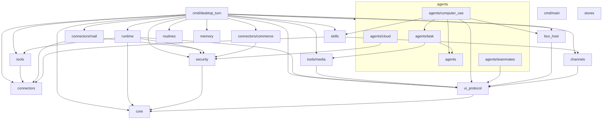

# 02 — 模块边界图

> Reference。入口摘要见 [`modules.md`](modules.md)。本文给出包职责、反向依赖禁令与 mermaid 图。

## 顶层布局

权威物理路径见 `modules.md` §1（**扁平根包**；`box_host` 顶层保留；CloudAgent 在 `agents/cloud`）。下文 `packages/` 仅为逻辑分组别名，勿再建平行树。

## 依赖图（与实际 `moon.pkg` 一致）

下图由各包 `moon.pkg` 的 `import` 块实测导出，不画"意图架构"——上一版把
`memory → core`、`stores → core`、`routines → runtime/security/core`、
`connectors → security` 等**并不存在**的依赖画了进去，读的人会以为这些包
互相咬合，实际上它们各自自足。虚线为 `for "test"` 专属依赖（只为测试引入，
不构成生产耦合）。

## 已知倒置（未修，记在这里而不是藏在图里）

依赖方向仍有三处不理想，属于已知债，不在本次修复范围内：

1. `tools → connectors`：`tools`（低层）反向依赖 `connectors`（适配层）。
   `connectors` 只在测试里反向依赖 `tools`，MoonBit 靠 `for "test"` 打断环路。
2. `skills → channels` / `skills → connectors`：`skills` 依赖渠道/连接器适配层。
3. `agents/computer_use → box_host`：computerUse 依赖 box 宿主表面。

## 包详表

### `core`

- **职责**：`TurnId`/`SessionId`/`UserId` 等 ID；`TimeZone`/`Instant` 与时区规则；
  公历日期运算；**工具名归一表**（`tool_names.mbt`）；**密钥形状规则表**
  （`secret_shapes.mbt`）。
- **不负责**：IO、策略、工具。
- **依赖**：无。
- **公开**：稳定值类型 + 两张被多处复用的规则表；禁止泄露 Host 句柄。
- **已删除**：`Error` 代数（`core/error.mbt`，全树零引用）、`MachineId`/`RoutineId`/
  `SkillId`/`SubagentId`（零引用）。错误统一走 `Result[..., String]`。

### `security`

- **职责**：`UntrustedFence`；`ActionClass`；`ApprovalGate`；Auto-review 判定输入/输出类型；
  **「记忆内容永不构成不可逆外发授权」的策略**（`guard.mbt`）。
- **不负责**：画审批卡；执行 Shell；OAuth；**不依赖 `memory`**（策略归策略，存储归存储）。
- **依赖**：→ `core`。
- **公开**：`classify` / `check` / `wrap_untrusted` / `parse_fences`。

### `ui_protocol`

- **职责**：`OutboundMessage`、`WidgetSpec`、`AttachmentRef`、`Delivery` trait。
- **不负责**：Slack/邮件字节协议；浏览器 DOM。
- **依赖**：→ `core`。
- **公开**：构造器 + `Delivery`；业务禁止手搓渠道 payload。

### `runtime`

- **职责**：`TurnContext` 状态机；`step`；Todo；后台完成唤醒；routine 触发接入点。
- **不负责**：具体 Tool 实现；子进程；**渠道适配**（`channels` 只在测试里引入）。
- **依赖**：→ `core`,`security`,`tools`,`ui_protocol`。
- **公开**：`open_turn` / `acknowledge` / `step` / `end_turn` / `on_background_complete`。

### `tools` + 顶层 `box_host`

- **职责**：内置工具描述与编排（box/desktop/machines/web/media/dynamic）。
- **不负责**：MCP 传输；真实 OS。
- **依赖**：`tools` → `connectors`；`tools/media` → `ui_protocol`；`box_host` → `ui_protocol`。
- **公开**：`ToolRegistry`；各子包 `ToolDesc` 注册表。

### `agents`（含 `agents/cloud`）

- **职责**：`SubagentHandle`；executor/computerUse/cloud/teammates 协议。
- **不负责**：云端账单；桌面驱动实现。
- **依赖**：见上图；`agents` 根包自足。
- **公开**：`AgentSpawner`；kind 枚举。

### `memory` / `routines` / `skills` / `stores`

- 见 `modules.md` 职责卡。共同：**逻辑在内核，字节在 Host store**。
- `memory` / `stores` / `routines` 各自自足（无生产依赖）。

### `connectors` / `channels`

- MCP/邮件/购买 vs 聊天渠道。外发一律经 `ApprovalGate`。
- `channels` → `ui_protocol`；`connectors` 生产自足（仅测试依赖 `tools`）。

### `cmd/desktop_turn` / `cmd/main`

- 唯一允许「依赖所有包」的组装根；把 Host 注入 runtime。
- `cmd/desktop_turn` 是生产内核入口（native）；`cmd/main` 只是启动横幅。

## 禁令

1. 任何包 import `cmd`。
2. `core` / `security` / `ui_protocol` import `tools|agents|channels|connectors`。
3. 业务包绕过 `ApprovalGate` 直接调 `HostAbi.deliver` 外发。
4. 循环依赖（`moon` 构建失败即缺陷）。
5. **能力矩阵的每条 PASS 行都必须有可机检的证据**：`scripts/prove_capability_matrix.mjs`
   校验 `docs/capability-matrix.md` 里每行的 `证据文件::测试名` 真实存在。
