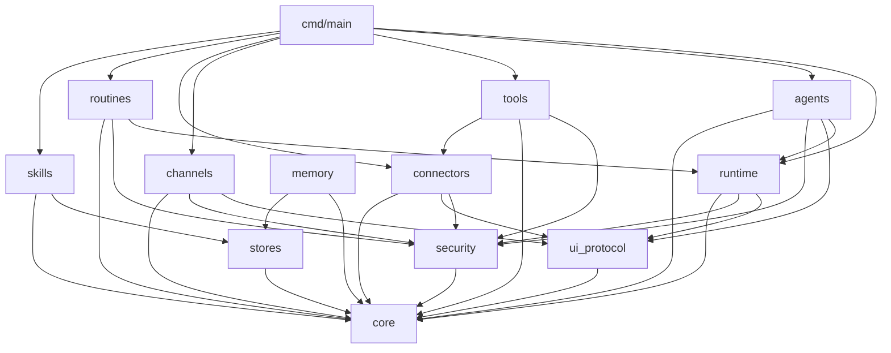

# 02 — 模块边界图

> Reference。入口摘要见 [`modules.md`](modules.md)。本文给出包职责、反向依赖禁令与 mermaid 图。

## 顶层布局

权威物理路径见 `modules.md` §1（**扁平根包**；`box_host` 顶层保留；CloudAgent 在 `agents/cloud`）。下文 `packages/` 仅为逻辑分组别名，勿再建平行树。

## 包详表

### `core`（逻辑曾写作 packages/core）

- **职责**：`TurnId`/`ToolCallId` 等 ID；`Error` 代数；`Result`；`TimeZone`/`Instant`；JSON/Schema 薄封装。
- **不负责**：IO、策略、工具。
- **依赖**：无。
- **公开**：稳定值类型；禁止泄露 Host 句柄。

### `security`

- **职责**：`UntrustedFence`；`ActionClass`；`ApprovalGate`；Auto-review 判定输入/输出类型。
- **不负责**：画审批卡；执行 Shell；OAuth。
- **依赖**：→ `core`。
- **公开**：`classify` / `check` / `wrap_untrusted` / `parse_fences`。

### `ui_protocol`

- **职责**：`OutboundMessage`、`WidgetSpec`、`AttachmentRef`、`Delivery` trait。
- **不负责**：Slack/邮件字节协议；浏览器 DOM。
- **依赖**：→ `core`。
- **公开**：构造器 + `Delivery`；业务禁止手搓渠道 payload。

### `runtime`

- **职责**：`TurnContext` 状态机；`step`；Todo；后台完成唤醒；routine 触发接入点。
- **不负责**：具体 Tool 实现；子进程。
- **依赖**：→ `core`,`security`,`ui_protocol`。
- **公开**：`open_turn` / `acknowledge` / `step` / `end_turn` / `on_background_complete`。

### `tools` + 顶层 `box_host`

- **职责**：内置工具描述与编排（box/desktop/machines/web/media/dynamic）。
- **不负责**：MCP 传输；真实 OS。
- **依赖**：→ `core`,`security`；`tools/dynamic` → `connectors/mcp`。
- **公开**：`ToolRegistry`；各子包 `ToolDesc` 注册表。

### `agents`（含 `agents/cloud`）

- **职责**：`SubagentHandle`；executor/computerUse/cloud/teammates 协议。
- **不负责**：云端账单；桌面驱动实现。
- **依赖**：→ `core`,`runtime`,`ui_protocol`,`security`。
- **公开**：`AgentSpawner`；kind 枚举。

### `memory` / `routines` / `skills` / `stores`

- 见 `modules.md` 职责卡。共同：**逻辑在 WASM，字节在 Host store**。

### `connectors` / `channels`

- MCP/邮件/购买 vs 聊天渠道。外发一律经 `ApprovalGate`。

### `cmd/main`

- 唯一允许「依赖所有包」的组装根；把 `HostAbi` 注入 runtime。

## 依赖图

## 禁令

1. 任何包 import `cmd`。  
2. `core` / `security` / `ui_protocol` import `tools|agents|channels|connectors`。  
3. 业务包绕过 `ApprovalGate` 直接调 `HostAbi.deliver` 外发。  
4. 循环依赖（`moon` 构建失败即缺陷）。
