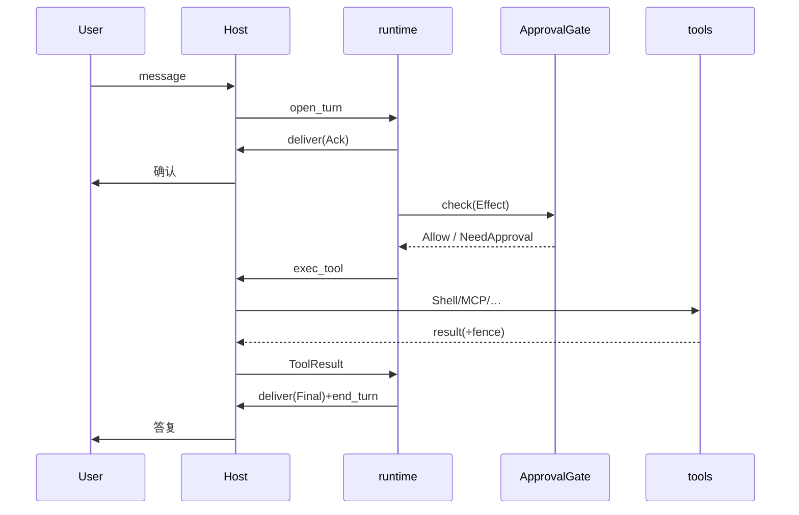

# 05 — 运行时回合生命周期

> Explanation。实现状态机以 `interfaces.md` / `04` 为准。

## 主路径

```
用户消息入站
  → channels.normalize_inbound → InboundMessage
  → runtime.open_turn → phase=Opened
  → 首条 acknowledge(SendToUser) → Acknowledged
  → Working：模型/策略选 Effect
       ├─ ToolCall → ApprovalGate → Host.exec_tool → ToolResult
       │     └─ untrusted=true → fence 后再进入上下文
       ├─ SpawnSubagent → handle 登记 → 并行 Running
       ├─ Memory/Skill 读写
       └─ MilestoneUpdate（长任务）
  → Finalizing：面向用户的最终答复
  → end_turn → Ended
```

## 相位不变量

| 相位 | 允许 | 禁止 |
|------|------|------|
| Opened | 建上下文、读记忆 | 对用户沉默太久（应尽快 Ack） |
| Acknowledged | 工具与子代理 | 跳过 Ack 直接 Ended（除非纯协议错误） |
| Working | Effect 批出 | 不可逆外发未过 Gate |
| Milestone | 进度文本 | 假装最终完成 |
| Finalizing | 最终答复 | 再拉长耗时工具（应回到 Working） |
| Ended | 无 | 同 turn_id 再 step（除非显式 reopen 策略） |

## 后台完成唤醒

1. 子代理/`AwaitShell` 完成 → Host 推 `BackgroundComplete` 事件。  
2. `runtime.on_background_complete` 打开短回合或恢复挂起 Turn。  
3. 向用户发里程碑或最终汇总；仍要 `end_turn`。  
4. 若父已 Ended：开 **continuation turn**（新 TurnId），文案标明续上。

## Routine 静默规则

- `silent_ok=true`：默认不 SendToUser；结果写 store/memory。  
- 失败、需审批、需用户决策：打破静默，投递 Widget/文本。  
- Routine **不**继承「任务描述当外发许可」；外发仍走 PERM。

## 与执行者子代理

- 父用 Task spawn executor；子回报只进父上下文。  
- 子**不能**直接 `DraftExternalMessage` 用户名义外发；草稿交父/主代理。  
- 子的最终 assistant 消息 = 给父的结果，不是给终端用户的气泡（除非产品规定转发）。

## 错误与取消

- 用户停止：子代理 stop；Turn Finalizing 说明已停止。  
- Gate Deny：记录原因，结束或改做可逆方案（真正降低权限，不绕过）。  
- Host 超时：Milestone 说明等待；可 AwaitShell。

## 时序草图


