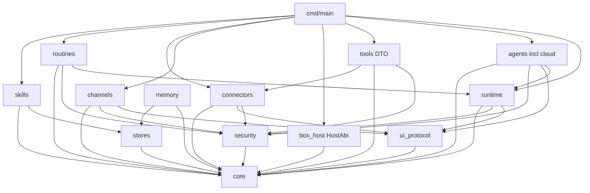

# Bit Bot 模块目录约定

> 权威入口。包级细节与 mermaid 依赖图亦见于 `02-module-map.md`。  
> MoonBit：每目录一个包，含 `moon.pkg`；黑盒测 `*_test.mbt`，白盒测 `*_wbtest.mbt`。

## 1. 顶层目录树（定稿 · 扁平包）

> Bitbot 2026-10-17 拍板：物理路径用**根级扁平包**；`box_host` 保留为 Host 适配；**无顶层 `cloud/`**，CloudAgent 在 `agents/cloud`。

```
/workspace/bitbot/
  docs/
  cmd/main/                 # boot：组装 HostAbi + 注册模块
  core/                     # ids / errors / time
  security/                 # fence / approval / autoreview
  ui_protocol/              # OutboundMessage / widget / end_turn
  runtime/                  # turn / scheduler / todo
  tools/                    # ToolCall/Effect/DTO 与 registry（无真实 OS）
  box_host/                 # Host 适配：Shell / FS / Desktop → HostAbi
  agents/
    cloud/                  # CloudAgent + Origin/GitHub（原顶层 cloud/ 迁入）
    # task / computer_use / teammates 可同级子包演进
  memory/
  routines/
  skills/
  connectors/               # mcp / mail / commerce
  channels/
  stores/
  AGENTS.md
  moon.mod
```

### 1.1 硬性边界

| 包 | 是 | 否 |
|----|----|----|
| `tools` | ToolDesc、ToolCall、Effect 描述、mock/invoke 编排 | 真实 Shell/FS/Desktop 实现 |
| `box_host` | HostAbi 出口：Shell/FS/Desktop FFI 适配 | 业务策略、Turn 状态机 |
| `agents/cloud` | CloudAgent 生命周期与协议 | 顶层再开一个 `cloud/` |
| `cmd/main` | 接线组装 | 业务逻辑 |

允许日后在 `tools` 内加请求 DTO；**副作用仍经 `box_host` → HostAbi**。

### 1.2 与脚手架对齐

见 `scaffold-status.md`。若仍存在空顶层 `/workspace/bitbot/cloud`，应迁入 `agents/cloud` 后删除顶层包（由 MoonBit核执行）。

## 2. 每包职责卡

| 包 | 职责 | 不负责 | 依赖方向 |
|----|------|--------|----------|
| `core/*` | ID、错误、Result、时间类型 | IO、策略 | 无业务依赖 |
| `security/*` | Fence、审批分类、Auto-review 策略类型 | 渲染审批卡、执行 OS | → `core` |
| `runtime/*` | Turn loop、调度、Todo | 具体工具实现 | → `core`,`security`,`ui_protocol` |
| `ui_protocol/*` | OutboundMessage、widget、attachment、end_turn 语义 | 渠道传输、Host 渲染细节 | → `core` |
| `tools/*` | ToolCall/Effect/DTO 与 ToolRegistry | 真实 Shell/FS/Desktop（归 `box_host`） | → `core`,`security`；dynamic → `connectors` |
| `box_host` | HostAbi：Shell/FS/Desktop 副作用出口 | Turn 策略、业务判定 | → `core`；由 `cmd` 注入 runtime |
| `agents/*` | 子代理句柄、队友；**`agents/cloud`** 承载 CloudAgent | 子进程本身（Host）；禁止顶层 `cloud/` | → `core`,`runtime`,`ui_protocol`,`security` |
| `memory/*` | 记忆事实模型、Recall/Update | 物理存储引擎 | → `core`；持久化经 Host/`stores` |
| `routines/*` | RoutineSpec、触发条件、静默策略 | 系统 cron 守护 | → `core`,`runtime`,`security` |
| `skills/*` | SkillRef、目录、加载顺序 | 技能正文托管策略细节 | → `core`,`stores` |
| `connectors/*` | MCP/邮件/购买连接器契约 | OAuth UI（Host） | → `core`,`security`,`ui_protocol` |
| `channels/*` | 渠道适配与 inbound 归一 | 用户身份主数据 | → `core`,`ui_protocol`,`security` |
| `stores/*` | store 路径约定、挂载元数据 | 业务语义 | → `core` |
| `cmd/main` | 接线 Host ABI、启动 runtime | 业务逻辑 | → 几乎所有包（仅组装） |

## 3. 依赖图（无环）



**禁止**：`core`/`security`/`ui_protocol` 依赖 `tools`/`agents`/`channels`；`memory` 不得依赖 `agents`。

## 4. 公开表面要点（实现前契约）

- `runtime`：`open_turn` / `step` / `end_turn` / `on_background_complete`
- `ui_protocol`：`OutboundMessage` 构造器族；禁止业务包直接拼 Host JSON
- `security`：`classify_action` → `ApprovalNeeded | Allow | Deny`；`wrap_untrusted` / `parse_fence`
- `tools`：统一 `ToolDesc` + `invoke(ctx, call) -> ToolResult`（描述层）
- `box_host`：`HostAbi.exec_tool` / FS / Desktop session
- `agents`：`SubagentHandle`；`agents/cloud`：CloudAgent 生命周期
- `memory`：`recall` / `update` / `list_facts`
- `routines`：`RoutineSpec` CRUD + `should_run_silent`
- `connectors.mcp`：`list_tools` / `call_tool` / `auth_status`
- `channels`：`normalize_inbound` / `deliver_outbound`（后者经审批）

类型签名见 [`interfaces.md`](interfaces.md) 与 [`04-interface-contracts.md`](04-interface-contracts.md)。

## 5. 与 ROADMAP 对齐

| 里程碑 | 优先包 |
|--------|--------|
| M1 Kernel + Delivery | `core`, `security`, `ui_protocol`, `runtime` |
| M2 Persistence | `memory`, `routines`, `skills`, `stores` |
| M3 Hosts | `box_host` + `tools`（machines DTO） |
| M4 Connectors & IO | `connectors/*`, `channels/*` |
| M5 Multi-agent | `agents/*`（含 `agents/cloud`） |
| M6–M7 | 垂直 skills + 硬化（不新增顶层域，补齐矩阵） |
